#### 20261113 Abraham Lake in Alberta, Canada (© Guang Cao/Getty Images)

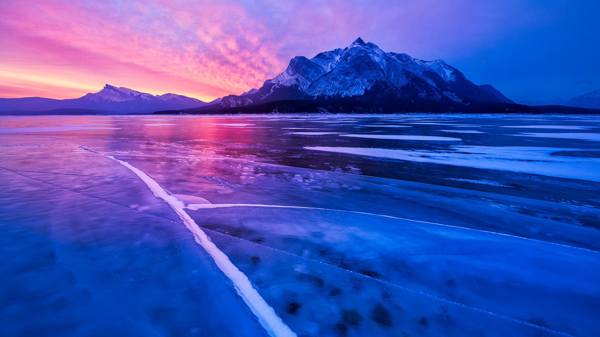

#### 20261112 North Window, Arches National Park, Moab, Utah (© lightphoto/Getty Images)

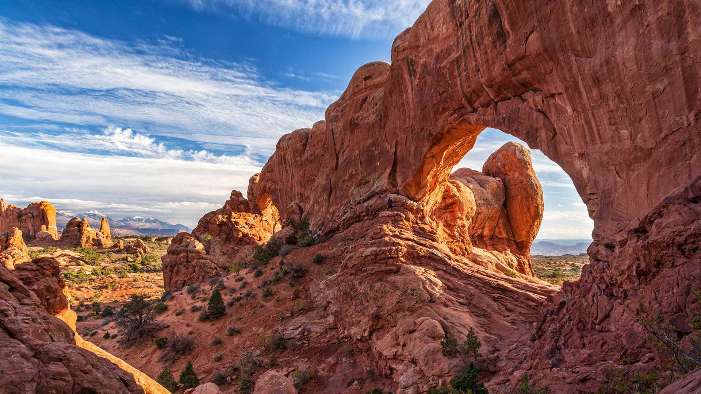

#### 20261111 American flags in a public park in upstate New York (© Matt Champlin/Getty Images)

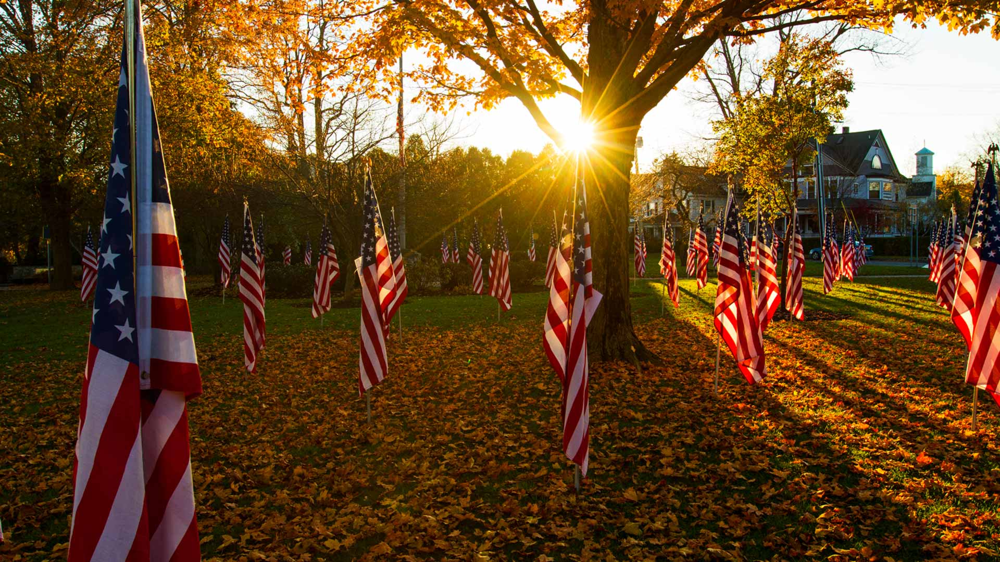

#### 20261111 大西洋森林，巴西 (© FG Trade/Getty Images)

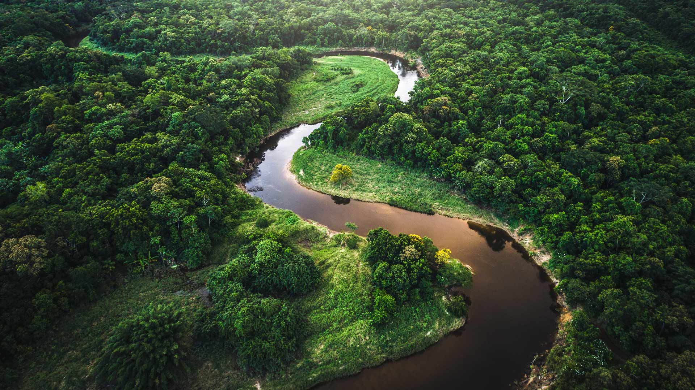

#### 20261111 Arc de Triomphe, Paris, France (© Beboy_ltd/Getty Images)

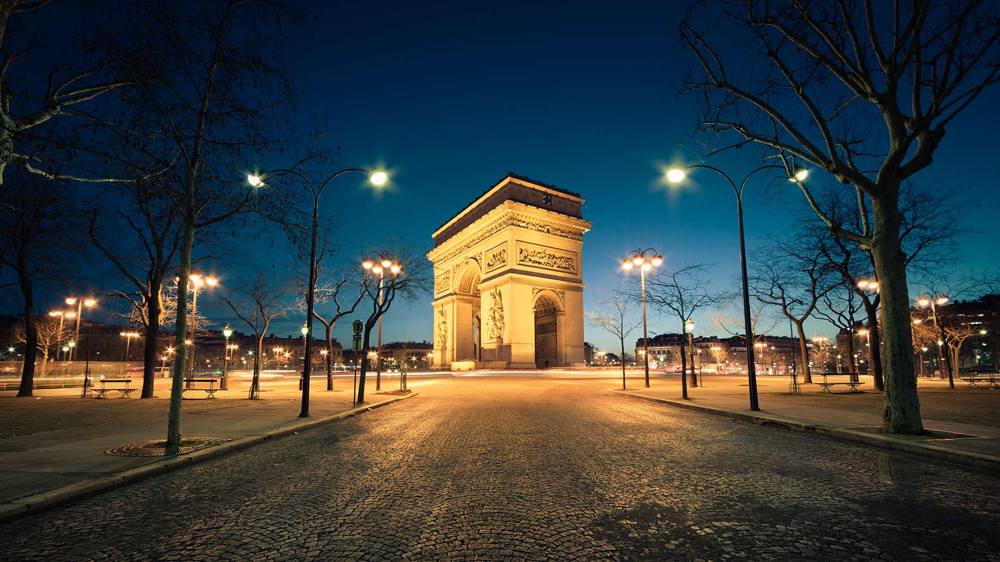

#### 20261110 Aerial view of Rose Island, The Bahamas (© Abstract Aerial Art/Getty Images)

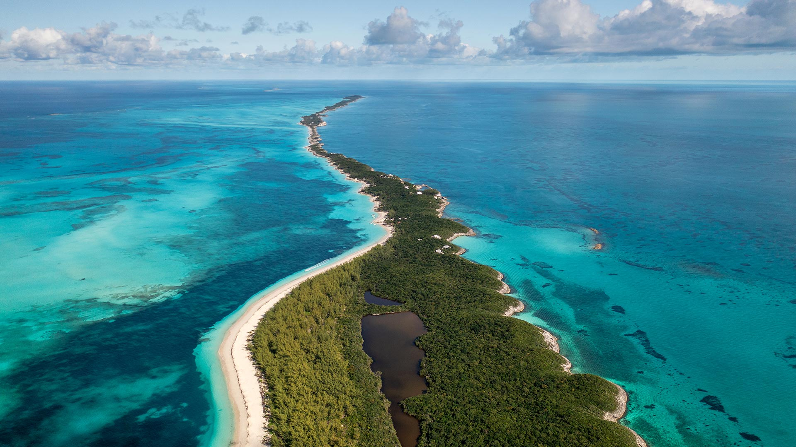

#### 20261109 Historic district of Triana, Seville, Spain (© Andrzej Rostek/Getty Images)

#### 20261109 Schüler spähen durch einen Spalt in einem noch erhaltenen Abschnitt der Berliner Mauer (© Sean Gallup/Getty Images)

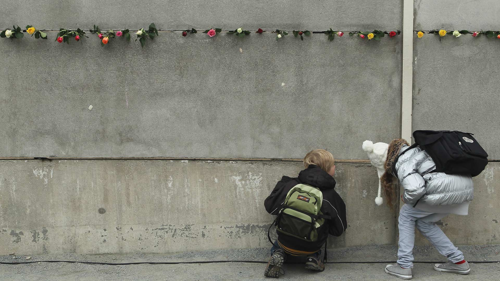

#### 20261109 Flamingos in Ebro Delta Natural Park, Catalonia, Spain (© mafrmcfa/Getty Images)

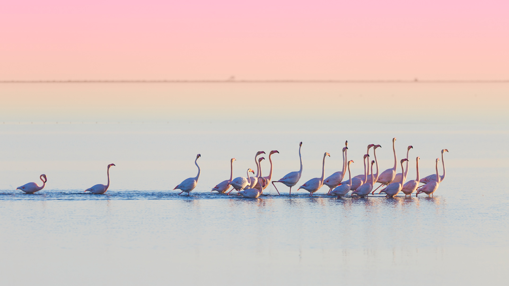

#### 20261108 Lanterns for Diwali, Mumbai, Maharashtra, India (© Dinodia Photo/Getty Images)

#### 20261107 A bison in the grasslands of Theodore Roosevelt National Park, North Dakota (© Tandem Stock/Adobe Stock)

#### 20261106 Bamboo forest, Pīpīwai Trail, Haleakalā National Park, Maui, Hawaii (© MNStudio/Getty Images)

#### 20261105 Wooden stile at a stone wall, Black Crag, Lake District, England (© Alex Treadway/Getty Images)

#### 20261104 Taquaras Beach, Balneário Camboriú, Brazil (© MaRabelo/Getty Images)

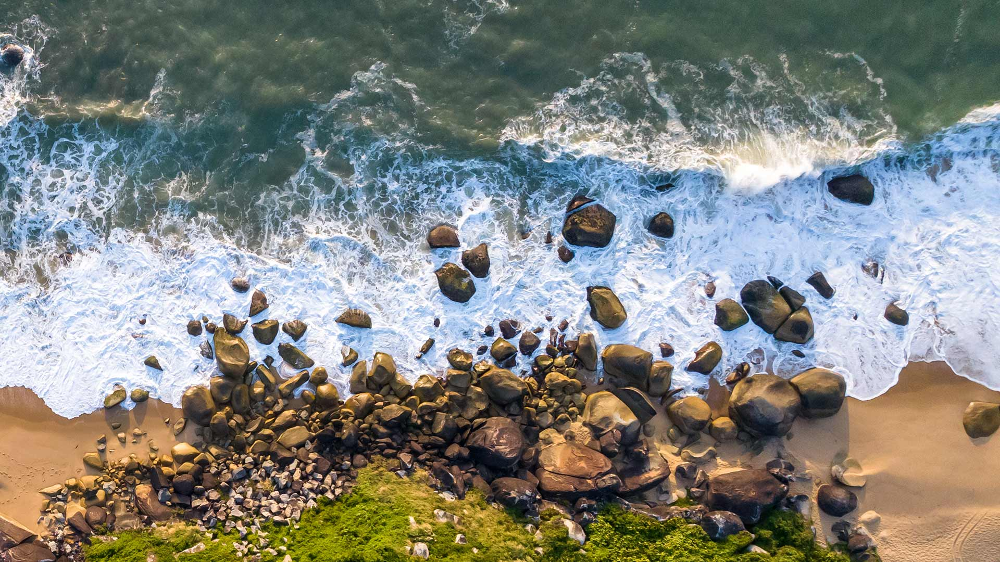

#### 20261104 People rowing among colorful bald cypress, Xuancheng, Anhui, China (© Jackal Pan/Getty Images)

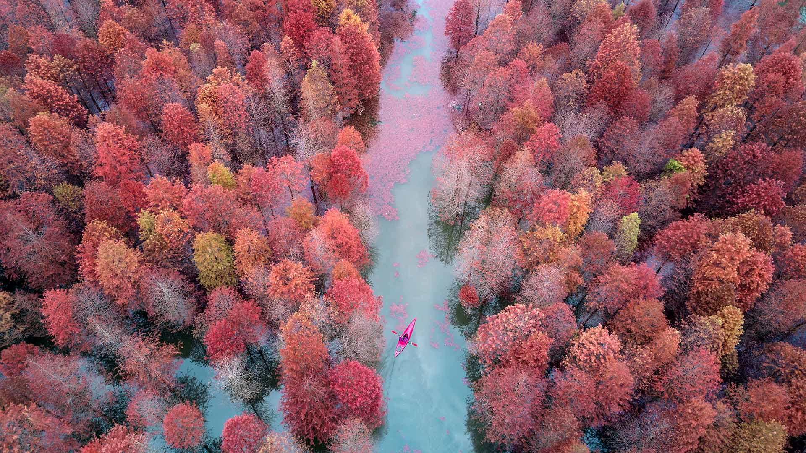

#### 20261102 Polar bear and cubs by Hudson Bay, Manitoba, Canada (© Danita Delimont/Adobe Stock)

#### 20261101 黑森林，巴登-符腾堡州，德国 (© Britus/Getty Images)

#### 20261101 Handmade baskets, Santa Fe, New Mexico (© Patrick Lane/Getty Images)

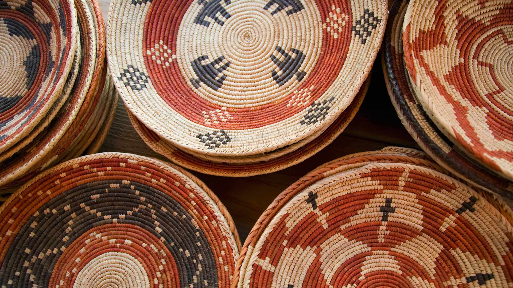

#### 20261101 Lake Braies, Fanes‑Sennes‑Braies Nature Park, Dolomites, Italy (© leonid_tit/Getty Images)

